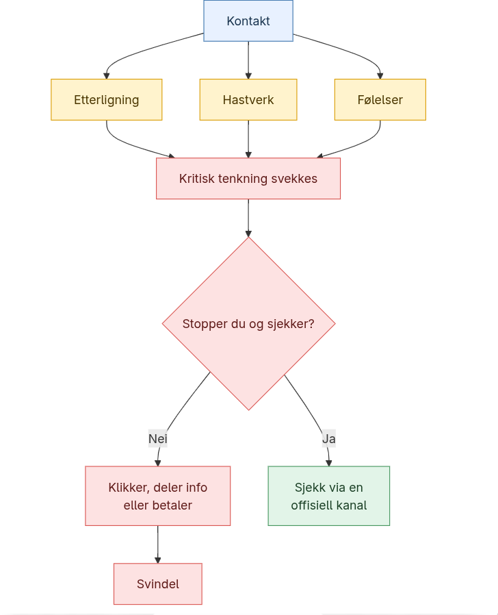

# Hvordan de lurer deg

Senere skal vi se på at svindler kan komme i mange forskjellige former, men det første man kanskje lurer på er hvordan blir folk lurt. Her er det tre hovedmetoder svindlere benytter for å få oss til å gå fem på.

## Etterligning
Den første metoden er etterligning, der svindlerne oftest etterligner troverdige nettsider eller personer. Disse falske kopiene er ofte veldig like de originale nettsidene og/eller personene, noe som gjør at hvem som helst kan bli lurt dersom de ikke ser tegn til at det ikke er ekte. Det hender også at man mottar en falsk e-post som ser ut til å være fra et kjent firma, og feil håndtering av dette kan være alt som skal til.

## Stress
Metode to er å skape hastverk og høyt stress. Når man ikke forventer at noe uventet skal skje, kan man fort bli satt ut av en plutselig reklame med en timer som tikker nedover, eller om noen som ringer utgir seg for å være fra banken. Om det er et stress-element med i en svindel kan svindlerne redusere kvaliteten av den kritiske tenkningen din, og du kan gå glipp av viktige detaljer.

## Følelser
Metode tre er litt lik nummer to i at den også spiller på følelser. I likhet med stress handler det om å få følelsene til å styre deg framfor kritisk tenking sentralt her. Dette kan ta flere former, for eksempel om noen ber om penger til en veldedighet som ikke finnes eller om en forelskelse man møter på nett begynner å be om penger.

Disse tre elementene, ofte også satt sammen, legger en god grunnmur for at svindlere kan lure deg. Svindlerne er svært utspekulerte, og teknikkene brukt har som mål å distrahere deg fra å stoppe opp å tenke om dette faktisk er ekte eller ikke.

<iframe
  src="../quizSikkerhets/"
  title="Quiz sur le phishing"
  width="100%"
  height="450"
  style="border: 0;">
</iframe>