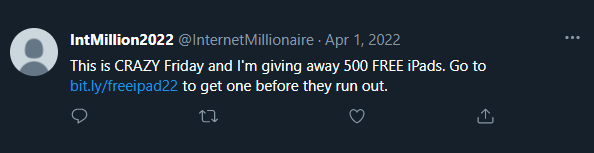

# Phishing

Du har kanskje fått en SMS om en pakke du ikke venter på, eller en e-post om at bankkontoen din må oppdateres. Meldingen kan se ekte ut, men være sendt av en svindler.

Dette kalles *phishing*, eller *nettfisking* på norsk. Svindleren prøver å lure deg til å gi fra deg opplysninger, betale penger eller gjøre noe som gir dem tilgang til kontoene dine. Ofte later svindleren som meldingen kommer fra banken, Posten, et parkeringsselskap eller en offentlig tjeneste. De kan også utgi seg for å være noen du kjenner.

 

## Hvordan foregår det?

Svindelen begynner ofte med en SMS eller e-post som ber deg trykke på en lenke. En lenke er tekst eller en knapp som åpner en nettside.

Meldingen kan for eksempel si:

- «Pakken din er stoppet. Betal 29 kroner for å få den levert.»
    
- «Kontoen din blir sperret. Logg inn for å bekrefte opplysningene dine.»
    
- «Du har betalt for mye. Trykk her for å få pengene tilbake.»
    

Lenken kan føre til en falsk nettside som ligner på nettsiden til virksomheten. Den kan ha riktig logo, kjente farger og et profesjonelt utseende. På siden blir du kanskje bedt om å skrive inn kortnummer, passord eller andre personlige opplysninger, men dersom du fyller inn opplysningene, kan de havne hos svindleren. 

!!! info "Et eksempel: En falsk parkeringsbot"
    
    Du får en SMS som ser ut til å komme fra et parkeringsselskap:

    «Du har en ubetalt parkeringsbot. Betal i dag for å unngå ekstra gebyr. Trykk på lenken nedenfor.»

    Kanskje har du nylig parkert på en betalingsplass. Derfor virker meldingen troverdig og siden du ønsker å ordne opp og unngå ekstra kostnader trykker du på lenken. Dem åpner en nettside med selskapets navn og logo, der blir du bedt om å skrive inn kortnummer, utløpsdato og sikkerhetskoden på kortet. Men i phising-tilfelle er nettsiden en kopi laget av svindlere og opplysningene du skriver inn, kan brukes til å forsøke å belaste kortet ditt.

    *Det å trykke på en lenke betyr ikke i seg selv at du har gitt fra deg kortopplysningene dine. Faren i dette eksempelet oppstår når du skriver dem inn på den falske siden.*

    Det tryggeste er å undersøke betalingskravet gjennom parkeringsselskapets offisielle app eller nettside, som du åpner selv. Om du ikke er kjent med dette kan du også søke opp bedriften meldingen utgir seg for å være og ringe nummeret de har oppgitt.

## Hva bør få deg til å stoppe opp?

Vær ekstra oppmerksom når en melding:

- **Sier at det haster.** Du må betale eller svare straks for å unngå problemer.
    
- **Ber om passord, koder eller kortopplysninger.** Svindleren kan hevde at dette er nødvendig for å hjelpe deg.
    
- **Kommer uventet.** Den handler om en pakke, betaling eller innlogging du ikke kjenner igjen.
    
- **Lokker med penger eller premier.** Du blir bedt om å oppgi opplysninger eller betale et lite beløp for å få noe.
    
- **Ber deg følge en lenke for å ordne et problem.** Lenken kan føre til en falsk nettside.
    

En melding kan være svindel selv om språket er godt og avsendernavnet ser riktig ut. Navn og logoer kan kopieres.

## Slik beskytter du deg: Stopp, tenk og sjekk

### 1. Stopp opp

Ikke la meldingen bestemme tempoet. Ta deg tid til å tenke kritisk før du trykker, svarer eller betaler.

### 2. Tenk gjennom det du har fått

Venter du faktisk på en pakke? Kjenner du igjen betalingskravet? Hvorfor blir du bedt om å oppgi disse opplysningene?

Du trenger ikke vite sikkert at noe er svindel for å velge en tryggere måte å undersøke saken på.

### 3. Sjekk gjennom en kanal du kjenner

Åpne virksomhetens app selv, eller skriv inn nettadressen du kjenner i nettleseren. Unngå å bruke lenken i meldingen når du er usikker. Vil du ringe, finn nummeret på virksomhetens offisielle nettside. For banken kan du også bruke nummeret på bankkortet ditt.

### 4. Hold passord og koder for deg selv

Ikke del passord eller BankID-koder med andre, uansett hvem de sier at de er. Ikke godkjenn en forespørsel i BankID som du ikke selv har startet, eller som du ikke forstår hva gjelder.

### 5. Be gjerne om hjelp

Vis meldingen til noen du stoler på hvis du er usikker. Dere kan undersøke den sammen. Du skal fortsatt holde passord og koder for deg selv.

## Hva gjør du hvis du allerede har trykket?

Hvis du bare har åpnet lenken: Lukk nettsiden. Ikke skriv inn opplysninger, last ned noe eller godkjenn forespørsler.

Hvis du har oppgitt kortopplysninger, delt BankID-informasjon eller godkjent noe du er usikker på: Ring banken med en gang. Fortell hva som har skjedd, slik at banken kan hjelpe deg med å sperre kort eller BankID ved behov.

Hvis du har oppgitt et passord: Bytt det gjennom tjenestens offisielle app eller nettside. Bruker du samme passord andre steder, må du bytte det der også.

!!! warning "Dokumenter"
    **Ta vare på dukumentasjon av hendelsen for eksempel gjennom et bilde. Det kan være nyttig når du skal forklare hva som har skjedd.**
